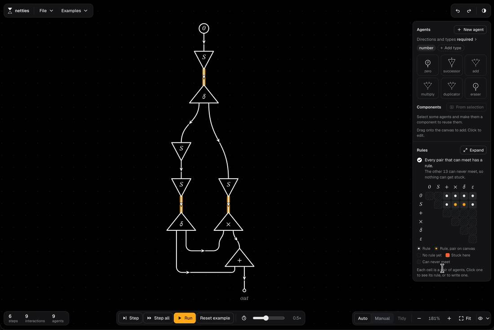

# Netties

> An interactive playground for interaction nets and Lafont's interaction combinators.

Netties is a visual tool that lets you build, explore, and simulate interaction nets right in your browser. Since this is a full frontend application rather than a library, the best way to understand what it can do is to just try it out!

**[Play with Netties live! 🚀](https://netties.adler.dev/)**



## Development

Netties is built with [SolidJS](https://www.solidjs.com/) and powered by [Vite](https://vitejs.dev/).

To run it locally:

```sh
# Install dependencies
npm install

# Start the dev server (http://localhost:5173)
npm run dev

# Run tests
npm test
```

## Codebase Tour

For those interested in how it works under the hood:

- `src/core` — The engine: nets, systems, reduction, port types, components, and the combinator translation.
- `src/layout` — Automatic placement and wire routing algorithms.
- `src/anim` — Step animation from the engine's wire lineage.
- `src/render` — SVG paths and standalone SVG export.
- `src/state` — The net model and the editor store.
- `src/ui` — SolidJS UI components.

## Credits

- Interaction nets ([1990](https://doi.org/10.1145/96709.96718)) and interaction combinators ([1997](https://doi.org/10.1006/inco.1997.2643)) are Yves Lafont's.
- The text format is a dialect of the notation of [Pin](https://eceasst.org/index.php/eceasst/article/download/2523/2697/2713) (Abubakar Hassan, Ian Mackie and Shinya Sato, 2008) and [Inpla](https://github.com/inpla/inpla) (Shinya Sato), in the tradition of Maribel Fernández and Ian Mackie's [calculus for interaction nets](https://doi.org/10.1007/10704567_10) (1999).

## Licence

Copyright 2026 Aron Adler. Netties is available under the
[PolyForm Noncommercial License 1.0.0](LICENSE).

You may use, modify, and share Netties for noncommercial purposes, along with
the educational and other organisational uses permitted by the licence.
For commercial use outside those permissions, contact
[Aron Adler](mailto:aron@adler.dev) to arrange a separate commercial licence.
