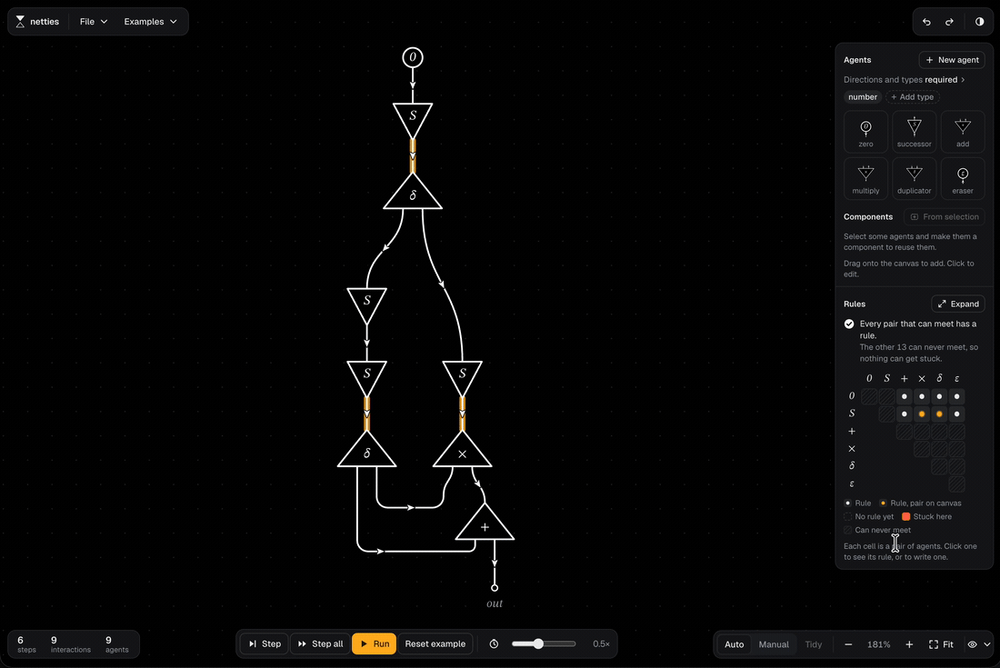

# Netties

> An interactive playground for interaction nets and Lafont's interaction combinators.

Netties is a visual tool that lets you build, explore, and simulate interaction nets right in your browser. Since this is a full frontend application rather than a library, the best way to understand what it can do is to just try it out!

**[Play with Netties live! 🚀](https://netties.adler.dev/)**



## Development

Netties is built with [SolidJS](https://www.solidjs.com/) and powered by [Vite](https://vitejs.dev/).

To run it locally:

```sh
# Install dependencies
npm install

# Start the dev server (http://localhost:5173)
npm run dev

# Run tests
npm test
```

## Codebase Tour

For those interested in how it works under the hood:

- `src/core` — The engine: nets, systems, reduction, port types, components, and the combinator translation.
- `src/layout` — Automatic placement and wire routing algorithms.
- `src/anim` — Step animation from the engine's wire lineage.
- `src/render` — SVG paths and standalone SVG export.
- `src/state` — The net model and the editor store.
- `src/ui` — SolidJS UI components.

## Archived TC formalization

The TC interaction-net Lean experiment is archived in
[`../boom/src/archive/triage`](../boom/src/archive/triage/README.md).
It is excluded from the default `boom` build. These commands explicitly
maintain the archive:

```sh
npm run formal:export  # regenerate its Lean rule table
npm run formal:check   # check the rule table and build TriageArchive
```

The current research target is a small universal interaction-net system with
native reflection of graph structure, including sharing. Its working brief
is in [`../boom/README.md`](../boom/README.md).
